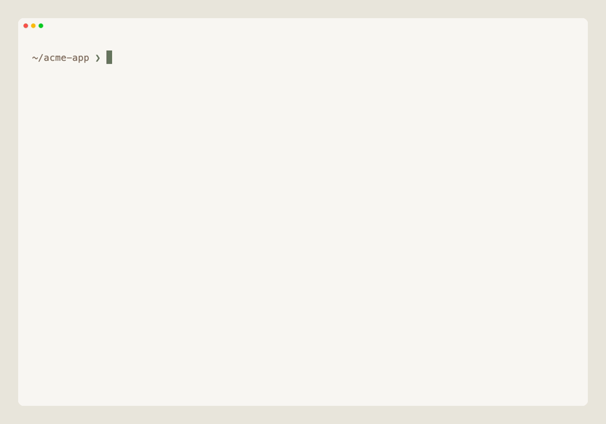

<div align="center">
  
  <h1>clonetree</h1>
  <p><strong>Copy your repo, node_modules and all, in seconds.<br>Only changes take up disk space.</strong></p>
  <p>Keep local edits, installed dependencies, and build output.</p>
  <p>
    <a href="#quick-start"><strong>Quick start</strong></a> ·
    <a href="#coming-from-git-worktrees"><strong>Git worktrees</strong></a> ·
    <a href="#everyday-usage"><strong>Usage</strong></a> ·
    <a href="#how-it-works"><strong>How it works</strong></a>
  </p>
  <p>
    <a href="https://github.com/sprisa/clonetree/actions/workflows/test.yml"></a>
    <a href="https://www.npmjs.com/package/clonetree"></a>
    <a href="LICENSE"></a>
  </p>
</div>

**clonetree** creates a working copy of the current directory using filesystem
clones. It provides a create/list/delete workflow similar to Git worktrees,
starting from the files on disk rather than a commit.

- **Clone local edits.** Uncommitted changes, untracked files, and ignored files
  are included.
- **Keep dependencies installed.** Existing dependency directories and build
  output are included alongside source files.
- **Share file storage.** Files are separate, but their existing data is not
  copied again. More space is used as either copy changes.

In our [APFS benchmark](#benchmark), a **57.1 GiB checkout** with **320,652 files**
cloned in **9.9 seconds** on average.

<picture>
  <source media="(prefers-color-scheme: dark)" srcset="docs/assets/demo-dark.gif">
  
</picture>

**Requires macOS with APFS, or Linux with reflink-enabled XFS/Btrfs.** Source and
destination must be on the same filesystem. No Git repository is required.

## Install

```sh
# Homebrew
brew install sprisa/tap/clonetree

# npm
npx clonetree

# Go 1.26+
go run github.com/sprisa/clonetree@latest
```

Or run without a global installation: `npx clonetree --help`.

## Quick start

From the directory you want to clone:

```sh
clonetree init               # Add *.clonetree/ to this directory's .gitignore
clonetree new my-feature     # Clone into ./clonetree/my-feature.clonetree/
cd clonetree/my-feature.clonetree

# Files, local edits, and installed dependencies are included.
```

`init` is a one-time convenience for ignoring snapshots. It doesn't create a
repository or a snapshot; `new` does the cloning. Directories ending in
`.clonetree` are skipped, so new snapshots don't contain your older ones.

Back in the original directory, list, measure, or remove your workspaces:

```sh
clonetree ls                 # Instant: IDs and paths
clonetree info               # Measures sizes, with live progress per snapshot
clonetree delete my-feature  # Removes the workspace, including its local changes
```

## Coming from Git worktrees

The equivalent commands:

| What you want to do | Git worktree | clonetree |
| --- | --- | --- |
| Create a workspace | `git worktree add ../my-feature -b my-feature` | `clonetree new my-feature` |
| List workspaces | `git worktree list` | `clonetree ls` |
| Remove a workspace | `git worktree remove ../my-feature` | `clonetree delete my-feature` |

The important difference is **what you start with**:

| | Git worktree | clonetree |
| --- | --- | --- |
| Starting point | A checked-out commit or branch | Your current directory, including local edits |
| Dependencies and ignored files | Not populated from the original workspace | Included if present in the source |
| Working-file storage | A separate working tree | Shared data blocks until files change |
| Git relationship | Linked to the same repository | Repository metadata is cloned as-is |

**Git worktrees already share Git objects.** Clonetree also shares the storage
behind working files, so a large `node_modules/` or build directory can come along
without another full copy of its contents.

A clonetree ID names a directory, not a branch. In a regular Git checkout with its
own `.git` directory, the clone gets its own Git metadata too: you can use the same
branch independently, or create a new one after entering the clone:

```sh
git switch -c my-feature
```

Commits and refs in that clone aren't automatically synchronized with the source;
share them through your usual Git remote. Clonetrees aren't registered in
`git worktree list`. If your source is a linked worktree or uses external metadata,
read the [repository metadata details](#repository-metadata) below.

## Everyday usage

### Choose a snapshot directory

The source is always your current directory. `--dir` (or `-d`) changes the parent
directory used by `new`, `ls`, `info`, and `delete`:

```sh
clonetree --dir ../workspaces new experiment
clonetree --dir ../workspaces ls
clonetree --dir ../workspaces delete experiment
```

This creates `../workspaces/experiment.clonetree/`. Relative paths are resolved
from the current directory; use the same parent when listing or deleting. Use
`--dir .` to create snapshots directly here instead of inside `./clonetree/`.

`ls`, `info`, and `delete` also accept the project folder: if `--dir` holds no
snapshots itself, they use its `clonetree/` folder, just as running them from
the project does. These are equivalent:

```sh
clonetree --dir ~/code/my-app info
clonetree --dir ~/code/my-app/clonetree info
```

`new` always creates directly in the folder you name.

### List and measure snapshots

`ls` (or `list`) prints snapshot IDs and paths immediately. It reads only the
snapshot directory, not the snapshots themselves:

```sh
clonetree ls
```

`info` measures how much disk each clone uses, and how much cloning saved
compared with an ordinary copy:

```
ID                 DISK USED    SAVED    FULL COPY
hotfix-login        22.9 MiB    99.2%      2.9 GiB
main                 9.1 MiB    99.6%      2.9 GiB
my-feature               0 B     100%      2.9 GiB
perf-experiment    171.7 MiB    94.5%      3.1 GiB
release-2-4              0 B     100%      2.9 GiB

5 snapshots · 203.6 MiB disk used · 14.6 GiB saved (98.6%) · measured in 2.0s
```

| Column | Meaning |
| --- | --- |
| `DISK USED` | Space only this clone takes, shared with no other clone, the original, or a filesystem snapshot. Deleting the clone frees roughly this much. |
| `SAVED` | The share of `FULL COPY` the clone doesn't use. |
| `FULL COPY` | The clone's logical file size: what an ordinary copy would take. |

On macOS, `DISK USED` comes from APFS, which calls it private size. On Linux,
it adds up each file's extents that XFS or Btrfs reports as not shared with
another file (`FIEMAP`). Either way it doesn't include each clone's own file
metadata (inodes and directory entries), so a fresh clone can show `0 B` while
`new` reports tens of MiB added on disk. On Btrfs with compression, it counts
uncompressed sizes. Filesystems that report neither show `n/a`.

Snapshots are measured concurrently. In a terminal, each row resolves as soon as
its snapshot is measured, while the rest show a progress bar, size so far, and
elapsed time. Percentages are estimated from the entry counts of your previous
interactive `info` run (kept in the user cache directory); a snapshot without a
previous count shows a live entry count instead.

Measuring `DISK USED` asks the filesystem about every file. When you only need logical
sizes, skip that work to use less CPU:

```sh
clonetree info --size-only
```

This shows `ID` and `SIZE` (logical size). It still walks the files.

`new` reports clone time and estimated additional disk usage.

### Control progress output

Interactive runs show the current phase and a running timer. APFS clones identify
the directory being cloned and advance checked-entry progress during metadata
validation. Per-file rates and ETAs are omitted for native batches. Terminals that
support it (OSC 9;4) also show progress in the tab or dock.

For plain output:

```sh
clonetree --no-progress new experiment
```

Non-interactive runs disable progress and colors automatically; `NO_COLOR` is
respected too. Progress is written to stderr, results to stdout.

### Shell completions

Tab-complete commands, options, and snapshot IDs (for `delete`, honoring
`--dir`). Homebrew installs completions for bash, zsh, and fish automatically.
Otherwise, add the line for your shell and open a new one:

```sh
echo 'source <(clonetree completion zsh)' >> ~/.zshrc
echo 'eval "$(clonetree completion bash)"' >> ~/.bashrc
clonetree completion fish > ~/.config/fish/completions/clonetree.fish
```

Bash completion works with or without the bash-completion package, including
macOS's bash 3.2.

### Stop a running command

Press **Ctrl+C** to cancel. Clonetree acknowledges the request immediately and
shows when it is removing the partial clone. Large partial trees can take several
seconds to delete.

Press **Ctrl+C again** to exit without waiting for cleanup. If a partial clone
remains, remove it with `clonetree delete <id>` using the same `--dir` parent.

`delete` stops on Ctrl+C too. The snapshot is then partly deleted; run the same
`clonetree delete <id>` again to finish.

## Benchmark

A **57.1 GiB** directory containing **320,652 files**, **59,778 directories**, and
**16,844 symlinks** was cloned on an Apple M4 Max with 128 GiB RAM, macOS 27.0.1,
APFS, and Go 1.27.3:

| Measurement | Result |
| --- | ---: |
| Mean clone time | **9.9s** |
| Mean process CPU time | **8.4s** |
| Mean peak resident memory (RSS) | **14.0 MiB** |
| Sampled peak Go heap | **4.9 MiB** |

Timing and RSS are means of two runs. Heap was sampled separately. Source
preparation, output verification, and deletion are excluded from the timings;
filesystem caches were not cleared. Results depend on entry count, filesystem
state, and other disk activity.

See [performance](PERFORMANCE.md) for workload details, memory scaling, and
benchmark commands.

## How it works

### Native copy-on-write

Clonetree scans the current directory. On APFS, ordinary subtrees use native
directory cloning; exclusions, special metadata, and unsupported directory-clone
operations use the native per-file path. The completed subtrees are checked for
exclusions and their directory timestamps are restored.

The new files initially share data blocks with the originals. Editing either file
allocates storage for its changes without changing the other file's contents.

| Platform | Native cloning |
| --- | --- |
| macOS | APFS clones |
| Linux | XFS/Btrfs reflinks; reflink support must be enabled |

Clonetree uses native cloning only, with no full-copy fallback. Ext4, Windows, and
cross-filesystem clones are unsupported. On macOS, metadata is read in native
batches with reusable buffers; standard metadata reads handle unsupported
filesystems and exceptional entries.

### Included files

- Hidden files, ignored files, installed dependencies, and any `.git` or `.sl`
  metadata are included. Git's ignore rules don't filter the clone.
- Directories ending in `.clonetree` are excluded at every depth, including the
  destination itself.
- Permissions, modification times, and symlink targets are preserved. Absolute
  symlinks still point to their original targets.
- Existing IDs are never overwritten. Failed or cancelled clones are removed.

### Repository metadata

Clonetree copies VCS metadata as-is, including lock files. It doesn't rewrite
linked/shared stores or absolute metadata paths. For a self-contained Git
workspace, start at a repository root with its own `.git` directory.

A linked Git worktree's `.git` file still points to its original metadata after
cloning. Submodules and external stores retain their references too. Cloning a
subdirectory doesn't automatically create a new checkout: Git or Sapling may still
discover the original parent repository.

### Storage and consistency

- Files share storage until either workspace changes. Old data stays allocated
  while any clone needs it; a clone's disk usage can grow when the original
  changes or is deleted.
- Added disk usage is estimated from filesystem free space. Other disk activity
  and delayed accounting can affect it.
- `DISK USED` excludes shared blocks, file metadata, and filesystem-wide overhead.
  Measurements are scanned live, and unavailable values appear as `n/a`.
- Cloning is not an atomic directory-wide snapshot. Stop writers and let VCS
  operations finish before cloning if you need a consistent starting point.

## Learn more

| Looking for… | Start here |
| --- | --- |
| Commands and flags | `clonetree --help` or `clonetree <command> --help` |
| Re-recording the README demo and social preview | [`docs/demo/record.sh`](docs/demo/record.sh) |
| Runtime, memory use, and benchmark commands | [Performance](PERFORMANCE.md) |
| Native APFS tests and XFS/Btrfs tests in Ubuntu Docker or a VM | [Testing](TESTING.md) |
| Logo and social-preview artwork | [Brand assets](docs/BRANDING.md) |

Licensed under [MPL 2.0](LICENSE).


