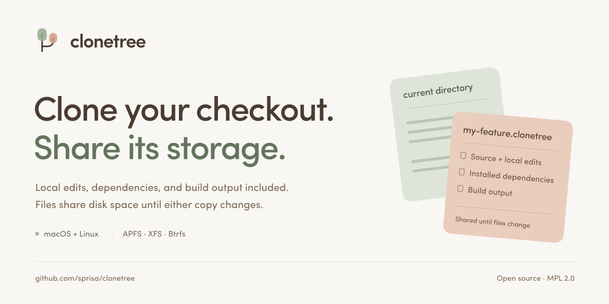

# Clonetree brand assets

The logo uses sage and clay geometric canopies with fine trunk-and-branch lines.
A continuing main stem gains a new side branch.


## Files

| Asset | Format | Dimensions |
| --- | --- | --- |
| [Logo source](assets/clonetree.svg) | SVG | 256 × 256 |
| [Logo export](assets/clonetree.png) | PNG | 512 × 512 |
| [Social preview source](assets/social-preview.svg) | SVG | 1280 × 640 |
| [Social preview export](assets/social-preview.png) | PNG | 1280 × 640 |

## Social preview



Upload `social-preview.png` under GitHub repository **Settings → General →
Social preview → Edit → Upload an image**.

The preview references `clonetree.svg`. Its overlapping workspace tiles illustrate
the checkout and its clone.

## Palette

| Color | Hex | Role |
| --- | --- | --- |
| Ink | `#4B3C32` | Wordmark, headings, and logo stem |
| Sepia | `#806B58` | Supporting text and side-canopy branches |
| Sage | `#A7B7A0` | Primary canopy |
| Deep sage | `#65745D` | Accent text and primary-canopy branches |
| Clay | `#D6AB91` | Side-branch canopy |
| Warm white | `#F8F7F3` | Background and logo disc |

## Typography and layout

Use **Sofia Pro**, with Helvetica Neue, Helvetica, and Arial as fallbacks.
Headlines are medium-weight with slightly tightened spacing; supporting text is
regular-weight and sentence case. Use generous whitespace, flat pastel
illustrations, and fine dividers.

## Copy

Describe what the tool does: clone the current directory, include local edits and
installed dependencies, and share file storage until either copy changes. Use
benchmark numbers with their platform and measurement context. Keep commands,
paths, and filesystem requirements explicit.

## Render PNGs

With [librsvg](https://gitlab.gnome.org/GNOME/librsvg) installed
(`brew install librsvg` on macOS) and Sofia Pro installed locally, run from the
repository root:

```sh
rsvg-convert -w 512 -h 512 docs/assets/clonetree.svg -o docs/assets/clonetree.png
rsvg-convert docs/assets/social-preview.svg -o docs/assets/social-preview.png
```

Keep the SVG sources together when rendering. Regenerate the PNGs after changing
the logo or preview source.
