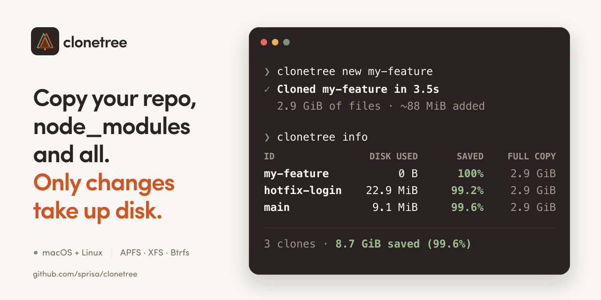

# Clonetree brand assets

The logo is two outlined pines, sage and burnt orange. Where they overlap, the
colors multiply like overprinted inks into a solid brown, and where their
outlines cross, the lines overprint too: two copies sharing storage. The
palette comes from a 1970s print: cream, burnt orange, and sage.


The mark uses only mid-tone colors, so the transparent version works on light
and dark backgrounds. Use a tile where the mark needs a shape of its own, such
as app icons and avatars. Keep the two pines in their own colors; the overlap
is what makes it read as two trees sharing. Earlier rounds are in
[logo explorations](assets/logo-explorations/README.md).

## Files

| Asset | Format | Dimensions |
| --- | --- | --- |
| [Logo](assets/clonetree.svg) ([PNG](assets/clonetree.png)) | SVG, transparent | 256 × 256 (PNG 512 × 512) |
| [Logo on dark tile](assets/clonetree-tile-dark.svg) ([PNG](assets/clonetree-tile-dark.png)) | SVG | 256 × 256 (PNG 512 × 512) |
| [Logo on cream tile](assets/clonetree-tile-light.svg) ([PNG](assets/clonetree-tile-light.png)) | SVG | 256 × 256 (PNG 512 × 512) |
| [Social preview source](assets/social-preview.svg) | SVG | 1280 × 640 |
| [Social preview export](assets/social-preview.png) | PNG | 1280 × 640 |
| [Terminal social preview](assets/social-terminal.png) | PNG (VHS) | 1280 × 640 |
| [README demo, light](assets/demo.gif) | GIF (VHS) | 1200 × 840 |
| [README demo, dark](assets/demo-dark.gif) | GIF (VHS) | 1200 × 840 |

## Social preview



Upload `social-preview.png` under GitHub repository **Settings → General →
Social preview → Edit → Upload an image**.

The preview references `clonetree-tile-dark.svg`. Beside the headline, a dark terminal
window shows real output: a clone finishing in seconds, then `clonetree info`
with each clone's disk use and the space saved. Keep its text large enough to
read at thumbnail size.

## Palette

| Color | Hex | Role |
| --- | --- | --- |
| Sage | `#7D9473` | Logo pine; progress bars and success in the CLI |
| Burnt orange | `#D2551F` | Logo pine; headline accent; suggested commands in the CLI |
| Cream | `#F1E6CF` | Light logo tile |
| Multiply brown | `#67310E` | Logo overlap: sage × burnt orange |
| Charcoal | `#2B2420` | Headings, dark logo tile, terminal windows |
| Sepia | `#806B58` | Supporting text |
| Warm white | `#F8F7F3` | Page background |

## Terminal recordings

The README demo and the terminal social preview are recorded with
[VHS](https://github.com/charmbracelet/vhs) using a terminal theme in this
palette, in light ([`docs/demo/light.tape`](demo/light.tape)) and dark
([`docs/demo/dark.tape`](demo/dark.tape)) themes. To re-record them after a UI
change:

```sh
brew install vhs
bash docs/demo/record.sh
```

The script builds clonetree, creates a sample project with installed
dependencies in a temporary directory (`go run ./docs/demo/fixture`), and
removes it afterwards. It also checks the recorded frames for layout jumps; see
[Testing](../TESTING.md#ui-layout-tests).

The CLI uses the palette's mid-tones, which stay legible on light and dark
terminals: sage for progress and success, burnt orange for suggested commands,
and neutral gray `#8C8C8C` for secondary text.

## Typography and layout

Use **Sofia Pro**, with Helvetica Neue, Helvetica, and Arial as fallbacks.
Headlines are medium-weight with slightly tightened spacing; supporting text is
regular-weight and sentence case. Use generous whitespace, flat colors, and fine
dividers. Show the product through real terminal output.

## Copy

Describe what the tool does: clone the current directory, include local edits and
installed dependencies, and share file storage until either copy changes. Use
benchmark numbers with their platform and measurement context. Keep commands,
paths, and filesystem requirements explicit.

## Render PNGs

With [librsvg](https://gitlab.gnome.org/GNOME/librsvg) installed
(`brew install librsvg` on macOS) and Sofia Pro installed locally, run from the
repository root:

```sh
cd docs/assets
for name in clonetree clonetree-tile-dark clonetree-tile-light; do
  rsvg-convert -w 512 -h 512 "$name.svg" -o "$name.png"
done
rsvg-convert social-preview.svg -o social-preview.png
```

Keep the SVG sources together when rendering. Regenerate the PNGs after changing
the logo or preview source.
